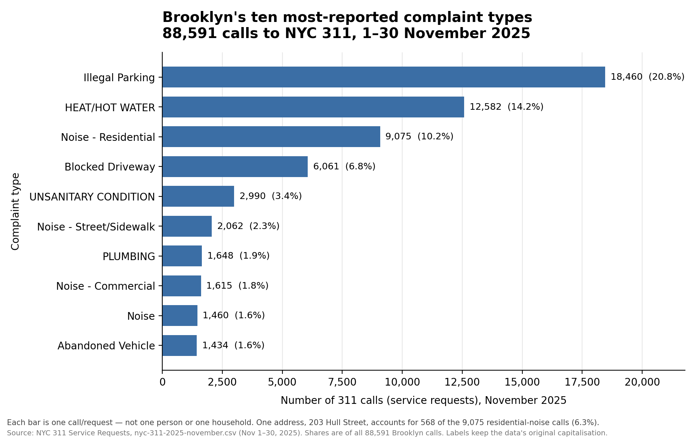
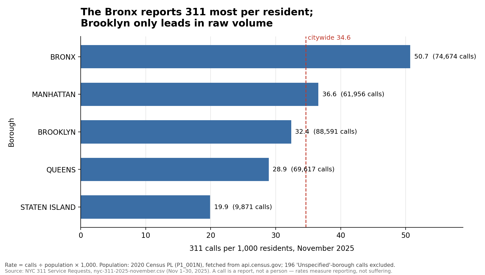
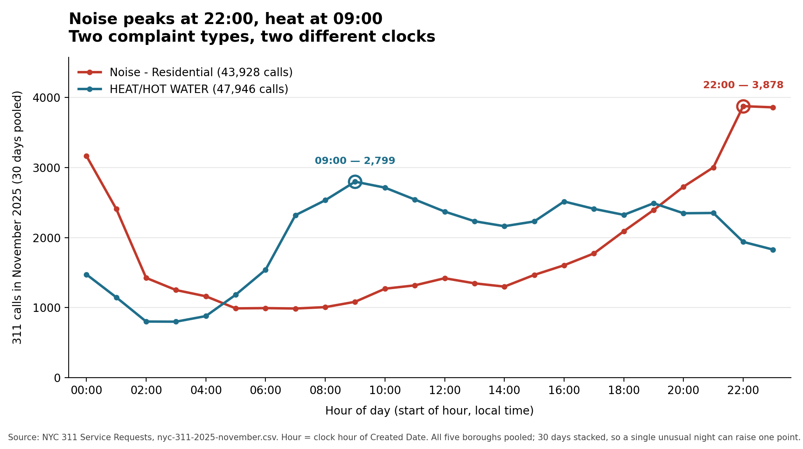

# Lab 11 — NYC 311, November 2025

Five questions about one month of New York City 311 service requests (304,905 rows,
1–30 November 2025), each answered with code, a figure, and a second, independent
recount of every number that appears in a heading, a table or a sentence of prose.

| Task | Question | Figure |
|---|---|---|
| 1 | What is in the file? | — |
| 2 | One borough in depth (Brooklyn) | `fig-borough-brooklyn.png` |
| 3 | Normalise by population | `fig-borough-per1000.png` |
| 4 | Hour of day, and the night that doesn't fit | `fig-hours.png`, `fig-nights.png` |
| 5 | The same job in five places | `fig-same-job.png` |
| 6 | One anomaly, chased | — |

---

## 0. Running this

```bash
# data (not committed — too large: 38 MB gz, 247 MB csv)
gunzip -k nyc-311-2025-november\(1\).csv.gz

# population table (needs a free key from api.census.gov/data/key_signup.html)
export CENSUS_API_KEY=...            # never committed; see .gitignore
python3 fetch_populations.py         # -> census_ny_counties.json, borough_populations.json

python3 lab11_answers.py             # Task 1 numbers
python3 borough_rates.py             # Tasks 3b-3c
python3 hourly_rhythm.py             # Task 4
python3 same_job.py                  # Task 5
python3 verify_all.py                # every headline number, twice (56 checks)
```

| File | Role |
|---|---|
| `lab11_answers.py` | Task 1: shape, distinct values, date range, open cases |
| `fetch_populations.py` | Task 3a: Census API pull, key from `$CENSUS_API_KEY` |
| `borough_rates.py` | Task 3b/3c: join, per-1,000 rates, `fig-borough-per1000.png` |
| `hourly_rhythm.py` | Task 4: hourly curves, `fig-hours.png`, `fig-nights.png`, `day_hour_heat.csv` |
| `same_job.py` | Task 5: median hours to close by borough, `fig-same-job.png` |
| `verify_all.py` | Recomputes every headline number with `csv` + `statistics` |
| `verify_output.txt` | Its output: **56/56 checks agree exactly** |

---

## 1. The file (Task 1)

| Number | Value | Verified (second method) |
|---|---|---|
| Rows | **304,905** | `csv.reader` record count — PASS |
| Columns | **44** | `len(header)` from the raw header line — PASS |
| Distinct `Problem (formerly Complaint Type)` | **174** | `collections.Counter` over the raw column — PASS |
| Earliest `Created Date` | **2025-11-01 00:00:04** | `datetime.strptime` min over all rows — PASS |
| Latest `Created Date` | **2025-11-30 23:59:52** | same, max — PASS |
| Rows with no `Closed Date` | **4,136** | blank-string count in `csv` pass — PASS |
| Their `Status` values | In Progress 3,402 · Open 300 · Pending 199 · Assigned 168 · Started 65 · Closed 2 | `Counter` over the same rows — PASS |

```python
# two ways: pandas' nunique() counts distinct non-null values, so blanks would be
# invisible in it; the csv pass counts keys in a Counter, which shows them.
df = pd.read_csv(FILE, usecols=COLS, dtype=str)          # A
df["Problem (formerly Complaint Type)"].nunique()        # -> 174
len(collections.Counter(row[i_prob] for row in csv_reader))   # -> 174

# two ways: the dates are TEXT.  "09/30" > "10/01" as a string, and AM/PM breaks
# within a day, so comparing raw strings is wrong in a way that never errors.
pd.to_datetime(df["Created Date"], format="%m/%d/%Y %I:%M:%S %p")   # A
[datetime.strptime(v, "%m/%d/%Y %I:%M:%S %p") for v in col]         # B
```

Blank is checked as a blank **string**, not as `NaN`, because the two are not the
same thing and pandas' default reader silently converts one into the other.

---

## 2. Brooklyn in depth (Task 2)

88,591 Brooklyn calls, **29.1%** of the file — the largest of the five boroughs.

| # | Complaint type | Calls | Share of Brooklyn | Verified |
|---|---|---|---|---|
| 1 | Illegal Parking | 18,460 | 20.8% | `Counter.most_common` — PASS |
| 2 | HEAT/HOT WATER | 12,582 | 14.2% | PASS |
| 3 | Noise - Residential | 9,075 | 10.2% | PASS |
| 4 | Blocked Driveway | 6,061 | 6.8% | PASS |
| 5 | UNSANITARY CONDITION | 2,990 | 3.4% | PASS |
| | **Top five together** | **49,168** | **55.5%** | sum of the five — PASS |



**The address trap.** 203 Hull Street (Brooklyn 11233, one BBL) filed **570 calls in
one month, 568 of them "Noise - Residential"** — **6.3% of every residential-noise
complaint in the borough** — on 29 of 30 days. Nothing else comes close: the top
address inside Illegal Parking is 100 Meserole Avenue with 206 calls (1.1%), across
9,266 distinct addresses, so Brooklyn's parking numbers are a genuine pattern, not
one building's grudge.

---

## 3. Population and rates (Task 3)

### 3a. Census pull

`GET https://api.census.gov/data/2020/dec/pl?get=NAME,P1_001N&for=county:*&in=state:36&key=$CENSUS_API_KEY`

62 county rows returned; five kept by FIPS.

| Borough | County (API `NAME`) | FIPS | Population 2020 | Verified |
|---|---|---|---|---|
| Bronx | Bronx County | 36005 | 1,472,654 | re-derived from raw JSON — PASS |
| Brooklyn | Kings County | 36047 | 2,736,074 | PASS |
| Manhattan | New York County | 36061 | 1,694,251 | PASS |
| Queens | Queens County | 36081 | 2,405,464 | PASS |
| Staten Island | Richmond County | 36085 | 495,747 | PASS |
| **Total** | | | **8,804,190** | sum of both routes — PASS |

The sanity check the lab asks for: ~8.8 million, and exactly the published 2020 count.
That rules out the two live failure modes — wrong column (`P1_002N`* is a race split,
housing units total ~3.5 M) and wrong counties (all 62 NY counties sum to ~20.2 M).

### 3b. Join and normalise

`calls.merge(population, on="Borough", validate="one_to_one")`. **196 `Unspecified`
rows are set aside** — 0.06% of the file, no population to divide by — leaving
304,709 calls over 8,804,190 people.

| Borough | Calls | Population | Per 1,000 | Raw rank | Rate rank | Verified |
|---|---|---|---|---|---|---|
| Bronx | 74,674 | 1,472,654 | **50.71** | 2 | 1 | both routes — PASS |
| Manhattan | 61,956 | 1,694,251 | **36.57** | 4 | 2 | PASS |
| Brooklyn | 88,591 | 2,736,074 | **32.38** | 1 | 3 | PASS |
| Queens | 69,617 | 2,405,464 | **28.94** | 3 | 4 | PASS |
| Staten Island | 9,871 | 495,747 | **19.91** | 5 | 5 | PASS |

```python
# two ways: the rate itself is one multiplication, but its two inputs come from
# two different code paths - pandas value_counts + the tidy JSON, versus a
# streaming Counter + the raw Census response.  They agree to 4 decimals.
```

Citywide rate 34.6 per 1,000 (304,709 / 8,804,190 × 1,000).



### 3c. Did the ranking change?

Three boroughs moved. Brooklyn falls from first to third (32.4 per 1,000), the Bronx
rises from second to first (50.7), Manhattan climbs from fourth to second (36.6), and
Queens slips from third to fourth (28.9); only Staten Island holds last (19.9).
Brooklyn's raw lead was mostly a population lead — 2.74 million residents is 31% of
the city — so once divided it lands below the citywide 34.6. My hypothesis is that
these rates track housing more than temperament: the Bronx has the densest, oldest,
most renter-heavy multi-family stock, where a dead boiler or a neighbour through a
shared wall is a concrete thing to report to a landlord. Manhattan's mix looks
different in kind, with heat/hot water at 18.5% of its calls and illegal parking
under 1%, consistent with dense rental households and fewer cars. This stays a
hypothesis, not a finding — 311 measures who calls, not who suffers, and a single
address can file hundreds of complaints.

---

## 4. Hour of day, and the night that doesn't fit (Task 4)

Two complaint types with opposite rhythms, `Created Date` parsed first
(`dtype object → datetime64[ns]`, 0 `NaT`).

| Metric | Value | Verified |
|---|---|---|
| Noise - Residential peak | **22:00, 3,878 calls** | `Counter` argmax — PASS |
| HEAT/HOT WATER peak | **09:00, 2,799 calls** | PASS |
| Brooklyn split: noise / heat | 22:00 (910) / 09:00 (845) | same query, borough filter — PASS |
| Bronx split: noise / heat | 23:00 (1,769) / 19:00 (934) | PASS |
| Day × hour heat map | **30 × 24 cells, 47,946 total** | grid rebuilt cell-by-cell — PASS |
| 11 November heat calls | **3,896** (2.4× the 1,598 mean) | PASS |
| 11 November 10:00 cell | **292** | PASS |



**Claim, in two sentences.** Residential noise peaks at 22:00 (3,878 calls) while
heat complaints peak at 09:00 (2,799) — seven hours apart, and both curves bottom out
between 02:00 and 05:00. That dead zone is the tell: these curves describe when people
are awake, not when the city is loud or cold.

**Does it survive splitting by borough?** In Brooklyn, yes — noise 22:00 (910), heat
09:00 (845). In the Bronx, no: noise peaks at 23:00 (1,769) and heat in the evening at
19:00 (934). The Bronx supplies 51% of all residential-noise calls, which is why the
citywide 22:00 and 23:00 points are only 17 calls apart.


**Five sentences.** Mostly, yes: every night runs near-silent from 02:00 to 05:00
(the busiest cell in that band all month is 82 calls) and crests between 07:00 and
12:00 on 17 of 30 days. One night does not fit — **Tuesday 11 November**, whose
**10:00** hour alone drew **292 calls** and whose day total reached **3,896, 2.4× the
month's average** (the 07:00–12:00 window took 1,417 calls against 478 on an ordinary
day). My explanation is weather, not plumbing: 11 November was the month's first cold
day (mean 36.4 °F, versus 49.2 °F on the 10th and 42.3 °F on the 12th, per the Open-Meteo archive, cached as `weather_nov.json`),
so tenants woke to radiators nobody had switched on. Two boring explanations die on
inspection: all 3,896 rows parse to real 11 November timestamps with **3,896 distinct
`Unique Key`s**, and only **37 (0.9%)** share an identical timestamp *and* address —
below the file-wide 2.9%. And it is a burst of real complaints, not a systems dump:
**2,495 addresses, 2,415 BBLs, 162 ZIPs, all five boroughs**, no address above 24 calls,
no minute above 17; removing the day entirely still leaves the heat peak at 09:00 (2,554),
so the morning rhythm is not an artefact of the cold snap.

---

## 5. The same job in five places (Task 5)

`HEAT/HOT WATER` only: one complaint type, **every row answered by HPD**, so a
borough gap cannot be a difference in the work.

| Borough | Closed cases | Median hours | Mean | 90th pct | Verified |
|---|---|---|---|---|---|
| Staten Island | 348 | **27.7** | 31.8 | 59.4 | `statistics.median` — PASS |
| Bronx | 16,663 | **30.8** | 32.9 | 56.3 | PASS |
| Manhattan | 11,425 | **34.2** | 36.4 | 62.0 | PASS |
| Brooklyn | 12,569 | **37.7** | 38.4 | 66.4 | PASS |
| Queens | 6,907 | **42.8** | 43.7 | 77.1 | PASS |

**Dropped: 34 open cases** (blank `Closed Date`, all `Status = Open`), leaving 47,912
closed cases. Two `Closed Date` values fall in 2026 and are kept; removing them leaves
Manhattan's median at 34.16 h either way.

```python
# two ways: groupby().median() on the dataframe, versus statistics.median on a
# plain list of floats read back out of the exported CSV.
df.groupby("Borough")["hours"].median()          # A  -> 42.84 (Queens)
statistics.median([float(r["hours"]) for r in csv.DictReader(f)])   # B -> 42.84
# spreadsheet route: heat_queens_closed.csv, =MEDIAN(D2:D6908) -> 42.84
```


**Paragraph.** The fastest borough closes heat cases in a median of 27.7 hours and the
slowest in 42.8 — a **15.1-hour gap, or 54% longer** — and it widens in the tail (90th
percentile 59.4 h on Staten Island versus 77.1 h in Queens). The "different jobs" excuse
is unavailable: one complaint type, one agency, and the ordering survives slicing by
resolution — Queens is slowest in *every* category (duplicates 37.8 h vs 19.0; heat
restored 50.3 h vs 27.7; violation issued 51.5 h vs 35.2). What is left is case mix and
capacity: building stock (NYCHA versus private, age, boiler type), repeat reporting (the
Bronx files 4.77 cases per building versus 2.95 on Staten Island, and repeat calls
collapse into duplicates that close on someone else's clock), the share of cases ending
in verified restoration (25.7% in Queens versus 14.4% in the Bronx — and verification is
the slow path), plus staffing, routing and travel across a huge, low-density borough. To
separate those I would want, in this file, building identifiers to collapse repeat calls
and complaint-level timestamps; and outside it, HPD violation and inspection records
with attempt-by-attempt timestamps, building registration and ownership, boiler type,
district inspector rosters, and repair-certification dates — because `Closed Date`
measures when a case was marked closed, not when the radiator got hot.

---

## 6. One anomaly, chased (Task 6)

**Five sentences.** I found one address that called 311 **728 times in November** —
78-15 Parsons Boulevard in Fresh Meadows, Queens (ZIP 11366, BBL 4068290001) — about 24
calls a day, every single day of the month. First I checked whether that was an artefact
of address spelling by grouping complaints on exact coordinates
(`groupby([lat.round(6), lon.round(6)]).size()`): the largest cluster was the lecture's
Bronx building at 14,362 calls, and the next was this one, with all 728 rows sharing one
address, one BBL and one pin on the map. Second I looked at what was being reported — 303
Noise - Vehicle (261 of them "Car/Truck Horn"), 77 Drug Activity, 72 Noise, 72 Noise -
Residential and **67 "Noise - House of Worship", which is 40% of that complaint type's
166 calls citywide** — and every one of the 728 arrived through the **ONLINE channel,
against 52% for noise complaints citywide**. Third I looked at timing: **262 of the 728
calls fall inside just 111 minutes**, the busiest minute holding four separate "Car/Truck
Horn" tickets filed within 25 seconds, while 728 distinct `Unique Key`s and a single BBL
rule out duplicated rows. My verdict is **"cannot tell from this file alone"** — a
genuinely loud house of worship with many furious neighbours and one resident (or a
script) filing the same complaint every few minutes look identical in these columns, and
telling them apart needs 311 account or IP identifiers, NYPD 107th Precinct response
logs, or HPD/DEP inspection outcomes with arrival times.

> Deliberately not used: the lecture's 14,362-call address in ZIP 10466, which the
> coordinate query surfaces first and which was already written up in Task 2's
> address-trap discussion.

---

## 7. Verification — every headline number, twice

`verify_all.py` reads the same file two ways — pandas, and the stdlib `csv` module with
`collections` / `statistics` — and refuses to print PASS unless the two agree exactly.
Full output in `verify_output.txt`.

```
56/56 checks agree exactly
```

| Task | Checks | Result |
|---|---|---|
| 1 — shape, distinct values, dates, open cases | 7 | 7 PASS |
| 2 — borough counts, Brooklyn top five, address trap | 13 | 13 PASS |
| 3 — populations, per-1,000 rates, rank order | 12 | 12 PASS |
| 4 — peaks, heat-map shape, 11 November | 8 | 8 PASS |
| 5 — open cases dropped, counts and medians | 11 | 11 PASS |
| 6 — Parsons address | 5 | 5 PASS |

The checks that matter most are the ones a chart cannot show: that `Created Date` is
text and must be parsed before it is compared; that a blank `Closed Date` is a blank
string, not `NaN`; that `nunique()` hides blanks; and that `median()` on a groupby is
robust to the two impossible 2026 `Closed Date` values that would wreck a mean.

---

## 8. LLM use

**What I asked for.** Scaffolding for five pandas analyses, the matplotlib code for five
figures, the Census API call, a cross-check harness, and prose drafts for the write-ups.

**What it got wrong, and how I caught it.**

1. **Keyless Census access.** The first fetch assumed the API would answer without a key;
   it returned `302 → missing_key.html`. Caught before writing any prose, by following the
   redirect chain (`curl -D -`), not by reading a JSON error.
2. **An invented chart subtitle.** An early `fig-borough-per1000.png` described the boroughs
   as ranging "85,913–88,591 calls" — a range that does not exist (the true range is
   9,871–88,591). Caught by rendering the PNG and reading the text, which is the only way;
   the code ran happily and the file looked fine.
3. **Overlapping annotations.** In the first `fig-same-job.png` the mean diamonds were drawn
   on top of the value labels ("27.7 h ◇(n=348)"). Caught the same way — looked at the image
   and rewrote the layout.
4. **A Python foot-gun.** `groupby(...).median.max()` crashed because `.median` is also a
   DataFrame method; the traceback caught it and the fix was `["median"]`.
5. **A sentence-limit violation.** The first Task 3c draft was six sentences against a
   three-to-five limit. Caught by counting, not by trusting the draft.
6. **Numbers presented without provenance.** Task 1's answers were initially just numbers.
   The question "how do I confirm it" is what produced the independent `csv`-module pass that
   later became `verify_all.py` — the verification column exists because the first answer
   was not checkable.
7. **The obvious anomaly.** Asked for "an anomaly", the model's most natural target was the
   lecture's own 14,362-call address. That would have answered a question already answered
   in class, so it was excluded by hand.

**What I did not take on trust.** Every figure was rendered and read before it was saved
into this report; every prose number was recomputed by `verify_all.py`; every claim about
"the same shape every night" was checked against the day × hour grid rather than the pooled
curve. The honest limit of all this: two independent code paths catch *implementation* errors,
not *conceptual* ones. If both routes share a wrong definition — of "closed", of "hour", of
"population" — they will agree beautifully and both be wrong.

---

## 9. Data, secrets, and what is not in the repo

- **No data files.** `.gitignore` excludes `nyc-311-2025-november*.csv`, the extracted CSV
  directory, every `*.csv.gz`, and `*.parquet`. The 38 MB archive and 247 MB extract stay
  local; the download link is in §0 and in the Census script's docstring.
- **No API key.** `fetch_populations.py` reads `$CENSUS_API_KEY`, then an untracked
  `.census_key` file, then `argv[1]`. `.census_key`, `.env` and `*.pyc` are ignored. The key
  appears in no committed file; `census_ny_counties.json` is the API's response body, which
  contains populations, not credentials.
- **What *is* committed:** the six scripts, the report, the five figures, `verify_output.txt`,
  `census_ny_counties.json` (3 KB of API evidence), `borough_populations.json`,
  `day_hour_heat.csv` and `heat_queens_closed.csv` (the two small extracts the verifications
  read back).
